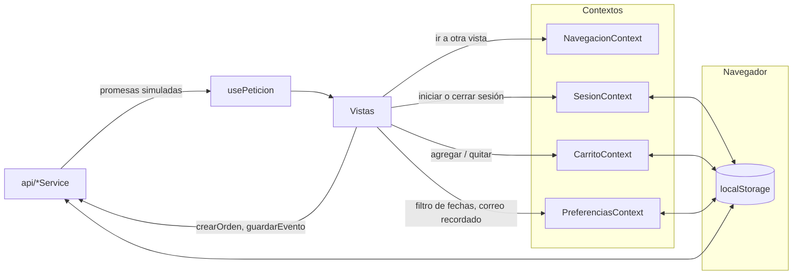

# Arquitectura de componentes y flujo de estado

Documento breve de la segunda entrega de TickNova (React 19 + Vite 8).

## Capas

```text
main.jsx
└── PreferenciasProvider → SesionProvider → CarritoProvider → NavegacionProvider → App.jsx
    ├── AppLayout        Encabezado · página · PiePagina
    │   ├── InicioPage, EventoDetallePage
    │   └── MisBoletosPage, PerfilPage (requieren sesión)
    ├── CompraLayout     encabezado con IndicadorPasos (paso 1 a 4 según la vista)
    │   ├── SeleccionPage (1) → CarritoPage (2) → PagoPage (3) → ConfirmacionPage (4)
    ├── AuthLayout       panel de marca + formulario
    │   └── IngresarPage (ingresar / crear cuenta), RecuperarPage
    └── AdminLayout      BarraLateral · página (solo administrador u organizador)
        └── DashboardPage, AdminEventosPage, EventoFormPage (crear y editar),
            InventarioPage, UsuariosPage (solo administrador), ReportesPage
```

| Carpeta | Responsabilidad |
|---|---|
| `src/data` | Datos simulados iniciales (eventos, usuarios, órdenes). |
| `src/api` | Servicios que simulan un servidor con promesas y `setTimeout`, validan y guardan en `localStorage`. |
| `src/context` | Estado compartido: navegación, sesión, carrito y preferencias. |
| `src/hooks` | `usePeticion` (carga/éxito/error con reintento y limpieza), `useEventos`, `useLocalStorage`, `useTitulo`. |
| `src/components` | Componentes reutilizables del Design System (botones, campos, tarjetas, estados, tablas, gráficos). |
| `src/layout` | Estructuras de página compartidas por grupos de vistas. |
| `src/pages` | Vistas: combinan componentes, leen el contexto y llaman a los servicios. |
| `src/utils` | Funciones puras: formatos, filtros, asientos, reportes, validaciones. |

Las vistas no acceden a `src/data` directamente para leer: lo hacen por medio de los servicios, igual que lo harían con una API.

## Flujo de estado



1. **Navegación.** `NavegacionContext` guarda la vista actual (`nombre` y `params`, por ejemplo `{ nombre: "detalle", params: { id: 3 } }`) y la conserva en `sessionStorage` al recargar. Los enlaces usan el componente `Enlace` y los botones la prop `vista`; ambos llaman a `ir(nombre, params)`. `App.jsx` elige la página y su estructura según la vista.
2. **Consulta de datos.** Una vista llama a `usePeticion(() => servicio(), [dependencias])`. El hook devuelve `estado` (`cargando`, `exito` o `error`), `datos`, `error` y `reintentar`. Si las dependencias cambian o el componente se desmonta, el resultado anterior se ignora (limpieza del efecto).
3. **Selección.** `SeleccionPage` guarda en estado local los asientos elegidos o la cantidad. El mapa de asientos se calcula con `generarMapaAsientos` a partir de la disponibilidad de la zona y de los asientos ya vendidos.
4. **Carrito.** Al agregar, los boletos pasan a `CarritoContext`. Subtotal, cargo por servicio y total no se guardan: se calculan a partir de los items en cada render.
5. **Pago.** `PagoPage` usa un formulario controlado con validación por campo. Mientras se procesa, el botón muestra "Procesando pago…" y queda bloqueado; una referencia (`useRef`) y el estado `procesando` impiden un segundo envío. Se crea una orden por cada combinación de evento y zona con `crearOrden`, que vuelve a validar disponibilidad y asientos.
6. **Confirmación y boletos.** La vista de confirmación recibe los códigos de las órdenes y las carga por código, así sigue funcionando si se recarga. `CodigoQR` genera el código en el navegador con un efecto que se limpia al desmontar.
7. **Panel.** Dashboard y reportes calculan sus indicadores con funciones puras de `utils/reportes.js` a partir de órdenes y eventos. Los eventos creados o editados se guardan con `guardarEvento` y aparecen en el listado público si están publicados.

## Persistencia

| Clave | Contenido |
|---|---|
| `ticknova_sesion` | Usuario con sesión iniciada (sin contraseña). |
| `ticknova_carrito` | Items del carrito. |
| `ticknova_preferencias` | Filtro de fechas de Inicio y correo recordado. |
| `ticknova_ordenes` | Compras realizadas en el navegador. |
| `ticknova_eventos` | Eventos creados o editados en el panel. |
| `ticknova_usuarios` | Cuentas registradas y cambios de perfil. |

La vista actual se guarda aparte, en `sessionStorage` (`ticknova_vista`).

## Vistas protegidas

En `App.jsx` cada vista indica si requiere sesión o un rol. Sin sesión, una vista protegida muestra el formulario de ingreso y, al iniciar sesión, se abre la vista pedida (por ejemplo, el pago). Desde "Ingresar", el cliente va al inicio y el administrador u organizador al panel. El panel exige rol administrador u organizador y la vista de usuarios exige rol administrador; con otro rol se vuelve al inicio.
