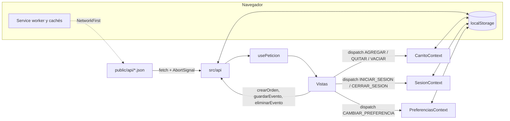

# Arquitectura de componentes y flujo de estado

Documento breve de la entrega final de TickNova (React 19, Vite 8, React Router 8 y PWA).

## Capas

```text
main.jsx
└── PreferenciasProvider → SesionProvider → CarritoProvider → RouterProvider (router.jsx) + AvisoPWA
    ├── AppLayout        Encabezado · AvisoConexion · Outlet · PiePagina
    │   ├── InicioPage, EventosPage, EventoDetallePage, NotFoundPage
    │   └── MisBoletosPage, PerfilPage (con RutaProtegida)
    ├── CompraLayout     encabezado con IndicadorPasos (paso 1 a 4 según handle de la ruta)
    │   └── SeleccionPage (1) → CarritoPage (2) → PagoPage /checkout (3) → ConfirmacionPage (4)
    ├── AuthLayout       panel de marca + formulario
    │   └── IngresarPage (ingresar / crear cuenta), RecuperarPage
    └── AdminLayout      BarraLateral · Outlet (RutaProtegida: administrador u organizador)
        └── páginas diferidas (lazy): DashboardPage, AdminEventosPage, EventoFormPage (crear y editar),
            InventarioPage, UsuariosPage y ReportesPage (solo administrador)
```

| Carpeta | Responsabilidad |
|---|---|
| `public/api` | Datos de la API falsa en JSON. |
| `src/api` | Acceso a datos: `fetch` con `AbortSignal`, latencia simulada, validaciones y escrituras en `localStorage`. |
| `src/context` | Estado global con Context y `useReducer` (sesión, carrito y preferencias). |
| `src/hooks` | `usePeticion` (carga/éxito/error, reintento y cancelación), `useEventos`, `useReducerPersistente`, `useTitulo`. |
| `src/components` | Componentes reutilizables del Design System. |
| `src/layout` | Estructuras compartidas por grupos de rutas (`Outlet`). |
| `src/pages` | Vistas: leen la URL, el contexto y llaman a los servicios. |
| `src/utils` | Funciones puras: formatos, filtros, asientos, reportes, validaciones. |

Los componentes no hacen `fetch` directamente: siempre pasan por los servicios de `src/api`.

## Flujo de estado



1. **Rutas.** `router.jsx` usa `createBrowserRouter` con `basename` (la app vive en `/TickNova/`). Los layouts muestran la página con `Outlet`. `RutaProtegida` revisa la sesión y el rol; sin sesión guarda la ruta de origen en `state.desde` para volver después de ingresar.
2. **Consulta de datos.** `usePeticion((signal) => servicio({ signal }), [dependencias])` crea un `AbortController` por petición, devuelve `estado` (`cargando`, `exito` o `error`), `datos`, `error` y `reintentar`, y cancela la petición anterior si cambian las dependencias o se desmonta la vista.
3. **Selección.** `SeleccionPage` lee el evento (`/eventos/:id`) y la zona (`?zona=`) de la URL, pide el evento y los asientos vendidos y guarda en estado local los asientos elegidos o la cantidad.
4. **Carrito.** Al agregar se despacha `AGREGAR` al reducer del carrito. Subtotal, cargo y total se calculan en cada render.
5. **Checkout.** `/checkout` es público, pero sin sesión pide ingresar y vuelve. El formulario es controlado y valida cada campo. Una referencia (`useRef`) y el estado `procesando` impiden un segundo envío. Se crea una orden por evento y zona con `crearOrden`, que vuelve a validar disponibilidad y asientos.
6. **Confirmación y boletos.** `/confirmacion?codigos=` carga las órdenes por código, así funciona al recargar. `CodigoQR` genera el QR en el navegador con el código de la orden.
7. **Panel.** Dashboard y reportes calculan sus valores con funciones puras de `utils/reportes.js` a partir de las órdenes; los reportes se filtran por evento y periodo. Crear, editar y eliminar eventos pasa por `eventosService`.

## Persistencia

| Clave | Contenido |
|---|---|
| `ticknova_sesion` | Usuario con sesión iniciada (sin contraseña). |
| `ticknova_carrito` | Items del carrito. |
| `ticknova_preferencias` | Filtro de fechas de Inicio y correo recordado. |
| `ticknova_ordenes` | Compras realizadas en el navegador. |
| `ticknova_eventos` | Eventos creados, editados o eliminados en el panel. |
| `ticknova_usuarios` | Cuentas registradas y cambios de perfil. |

## PWA

`vite-plugin-pwa` genera el manifest y el service worker. El app shell se guarda al instalar (precache); la API usa NetworkFirst, las imágenes CacheFirst y las rutas de la SPA caen en `index.html` (`navigateFallback`). `AvisoPWA` usa `useRegisterSW` para mostrar "nueva versión disponible" y "lista para usarse sin conexión"; `AvisoConexion` escucha los eventos `online` y `offline`.

## Decisiones

- La API falsa lee JSON con `fetch` (y no módulos de JavaScript) para que el service worker pueda guardar sus respuestas y la app funcione sin conexión.
- Eliminar un evento es una baja lógica para no perder ventas en los reportes ni boletos de los clientes.
- Las páginas del panel se cargan de forma diferida porque solo las usan administradores y organizadores.
- La nueva versión del service worker espera a que el usuario pulse "Actualizar", para no recargar la página en medio de una compra.
